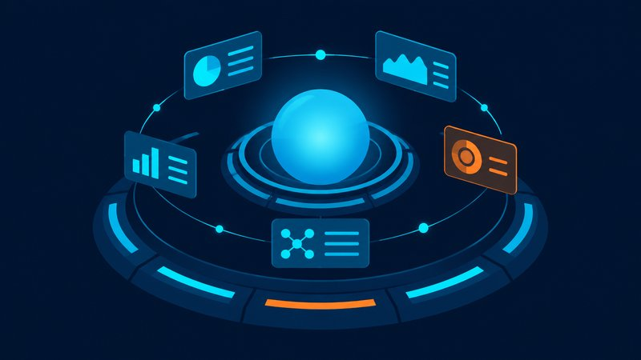
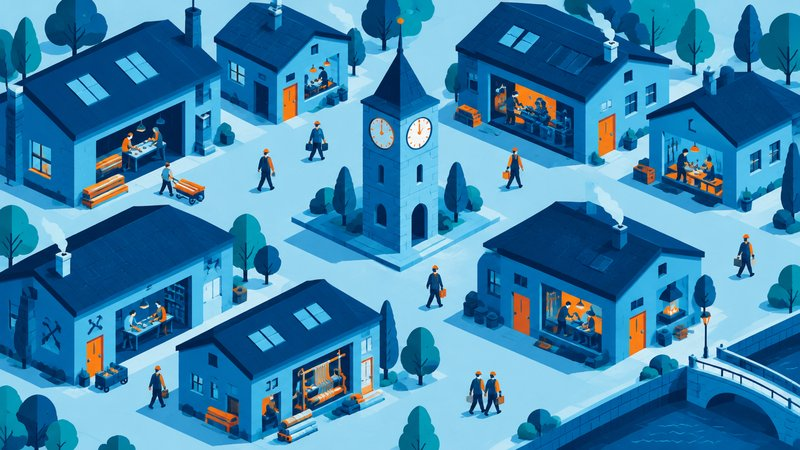
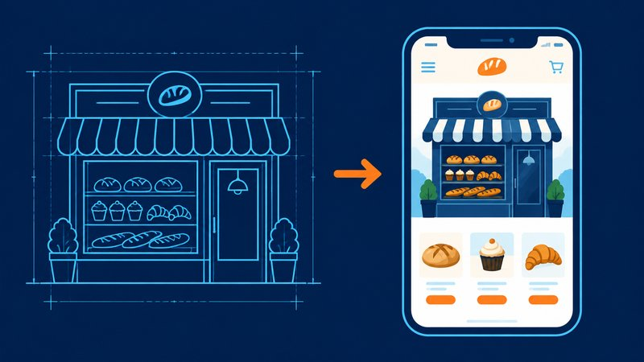
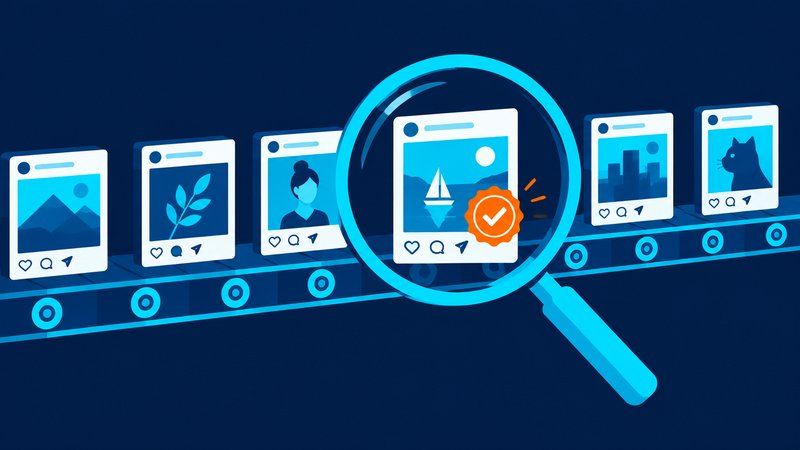
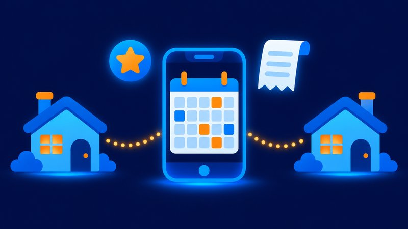

 

  

**Buduję systemy AI, które prowadzą małą firmę:** od pozyskania klienta, przez prototyp i ofertę, po marketing i codzienny nadzór. 
Założyciel [Cyfrowni](https://cyfrownia.com), agencji AI z Grudziądza.

<i>I build AI systems that run a small business end to end: client acquisition, prototypes and offers, marketing, daily operations.</i>

  

 

## Systemy, które zbudowałem

<table>
<tr>
<td width="50%" valign="top">

<h3><a href="https://github.com/jeyzamm-pixel/dexter-command-center">D.E.X.T.E.R. Command Center</a></h3>
Panel dowodzenia firmą z asystentem głosowym w centrum. Decyzje zamiast powiadomień. 
<i>Command center with a voice assistant at its core.</i>  
  
</td>
<td width="50%" valign="top">

<h3><a href="https://github.com/jeyzamm-pixel/agent-crew-orchestrator">Agent Crew Orchestrator</a></h3>
55 agentów na serwerze, jeden dyspozytor, pilnowanie budżetu i izolacja kluczy. 
<i>55 scheduled agents, one dispatcher, budget guard, key isolation.</i>  
  
</td>
</tr>
<tr>
<td width="50%" valign="top">

<h3><a href="https://github.com/jeyzamm-pixel/ai-prototype-builder">AI Prototype Builder</a></h3>
Firma na wejściu, działający prototyp strony z czatem, kreatorem wyceny i asystentem głosowym na wyjściu. 
<i>Company in, working website prototype with chat, quote wizard and voice demo out.</i>  
  
</td>
<td width="50%" valign="top">

<h3><a href="https://github.com/jeyzamm-pixel/client-acquisition-pipeline">Client Acquisition Pipeline</a></h3>
Research, ocena leadów, prototyp, wizyta, oferta. Zaprojektowany pod prawo: zero zimnego kontaktu. 
<i>Research, lead scoring, prototype, visit, offer. Designed around the law.</i>  
  
</td>
</tr>
<tr>
<td width="50%" valign="top">

<h3><a href="https://github.com/jeyzamm-pixel/content-engine">Content Engine</a></h3>
Marketing na autopilocie z sędzią jakości, zgodą przez odcisk treści i strażnikiem publikacji. 
<i>Autonomous marketing with a quality judge and fingerprinted approvals.</i>  
  
</td>
<td width="50%" valign="top">

<h3><a href="https://github.com/jeyzamm-pixel/assistant-engine">Assistant Engine</a></h3>
Jeden silnik dla czatbotów i asystentów głosowych wielu firm. Reguły pilnowane w czterech warstwach. 
<i>One engine for many companies' chat and voice assistants.</i>  
  
</td>
</tr>
<tr>
<td colspan="2" valign="top">
<table><tr>
<td width="50%"></td>
<td width="50%" valign="middle">
<h3><a href="https://github.com/jeyzamm-pixel/family-organizer-app">Family Organizer App</a></h3>
Aplikacja dla rodziny z dwoma domami: kalendarz opieki, gra w obowiązki, paragony czytane przez AI, przypomnienia push. <b>Używana codziennie.</b> 
<i>Family app for two homes. Used daily.</i>  
 
</td>
</tr></table>
</td>
</tr>
</table>

Kod produkcyjny jest prywatny, bo zawiera dane klientów i infrastrukturę. Repozytoria powyżej to wizytówki: architektura, decyzje projektowe, działające przykłady na fikcyjnej firmie.

 

## Jak myślę o systemach

<table>
<tr>
<td width="50%" valign="top">
<b>🗂 Jeden rejestr, jedno źródło prawdy</b> 
Model, harmonogram, klucz i budżet agenta żyją w jednym pliku, nie rozsiane po kodzie.
</td>
<td width="50%" valign="top">
<b>🧪 Zakaz bez testu jest życzeniem</b> 
Czego AI ma nigdy nie powiedzieć, tego pilnuje kod i test, a nie prośba w prompcie.
</td>
</tr>
<tr>
<td width="50%" valign="top">
<b>✅ Człowiek zatwierdza, maszyna wykonuje</b> 
Decyzje trafiają do panelu. Nic nie rusza, dopóki ktoś nie kliknie.
</td>
<td width="50%" valign="top">
<b>📡 Cisza to też sygnał</b> 
Każdy proces melduje się na zewnątrz. Brak meldunku jest alarmem.
</td>
</tr>
</table>

 

## Stack

 

 

 

📍 Grudziądz, Polska · Pracuję z firmami z całej Polski, na miejscu i zdalnie

**Masz w firmie rzecz, którą ktoś robi ręcznie codziennie?** Napisz: [biuro@cyfrownia.com](mailto:biuro@cyfrownia.com)

